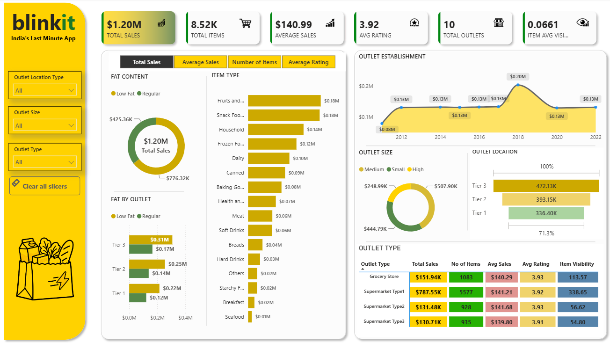

  <strong>Power BI • DAX • Power Query • Data Visualization</strong>

  
  
  

---

## 📌 Project Overview

**Blinkit Grocery Sales Analysis** is an interactive business intelligence project built using Microsoft Power BI. It explores sales performance across product categories and outlet segments using a sample grocery dataset.

The dashboard converts raw data into visual insights to support sales comparisons and business analysis.

## 🎯 Business Problem

The objective is to understand how sales vary across:

- Product categories and fat-content groups
- Outlet locations and outlet types
- Outlet establishment years
- Key sales and product performance indicators

## 🛠️ Tech Stack

| Tool | Purpose |
|---|---|
| Microsoft Power BI | Interactive dashboard and visualizations |
| Power Query | Data cleaning and transformation |
| DAX | KPI measures and calculations |
| Microsoft Excel | Source data |

## 🧹 Data Cleaning

- Standardized inconsistent labels in `Item Fat Content`.
- Reviewed missing values in `Item Weight`.
- Investigated zero values in `Item Visibility`.
- Preserved original records rather than blindly deleting or imputing values.

## 📊 Dashboard Highlights

### Key Performance Indicators

- Total Sales
- Total Items
- Average Sales
- Average Rating
- Total Outlets
- Average Item Visibility

### Visualizations

- Sales by Fat Content
- Sales by Item Type
- Sales by Outlet Location
- Sales by Outlet Establishment Year
- Outlet Performance Comparison

### Interactive Features

- Slicers for exploring data segments
- Dynamic metric selector
- KPI cards and interactive charts

## 🖼️ Dashboard Preview

  

## 💡 Key Insights

- Regular-fat products contribute more total sales than low-fat products in this dataset.
- Sales vary across product categories and outlet segments.
- Fruits & Vegetables and Snack Foods are among the leading item categories by sales.
- Comparing outlet characteristics helps identify differences in sales performance.

These findings describe the sample dataset and do not establish the causes behind sales differences.

## 📈 Business Recommendations

- Review product assortment using category-level sales performance.
- Investigate differences across outlet locations and outlet types.
- Compare sales with profit margins, inventory, and operating costs before making decisions.
- Validate findings using actual business data before implementing changes.

## 📁 Repository Contents

| File | Description |
|---|---|
| `Blinkit_Grocery_Analysis_Project.pbix` | Power BI dashboard project |
| `BlinkIT Grocery Data.xlsx` | Source dataset |
| `Blinkit_Dashboard.png` | Dashboard preview |
| `Blinkit_Grocery_Sales_Analysis_Portfolio.pptx` | Project presentation |

## 🚀 How to Explore the Project

1. Download the `.pbix` file from this repository.
2. Open it in Microsoft Power BI Desktop.
3. Explore the dashboard using its slicers and metric selector.

## 📚 Dataset Source

The project uses a sample Blinkit grocery dataset for educational and portfolio analysis. Credit the original Kaggle dataset here if Kaggle was the source from which it was downloaded.

**Disclaimer:** This is an independent portfolio project using sample data. It is not an official Blinkit report or verified internal company data.

## 👨‍💻 Author

**Akash Das**  
Aspiring Data Analyst | Excel | SQL | Power BI | Python

---

